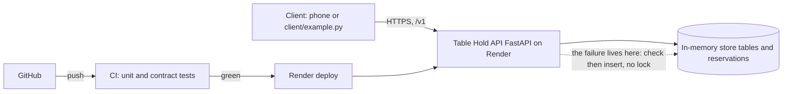

# Table Hold — Project Proposal

## The pitch

A player who wants a table at their game store tonight needs to see which tables are free and hold one for a session. It does that by listing tables and creating a reservation for a block of time. It goes wrong when two groups are both told the same table is theirs.

## Scope

One store, two resources (tables and reservations), seven operations. In for Milestone 2: everything in `openapi.yaml` v1, deployed on Render, with `client/example.py` able to list, hold, and show a conflict. Stretch, and not part of Milestone 2: accounts, payments, inventory, store admin, and a lock that stops two near-simultaneous creates from both succeeding.

## Users

Primary: a player booking from their phone before they head to the store. Forgotten: the group that already holds the table. They never call the API, and a wrong answer costs them the seat.

## The failure that matters

Two creates for the same table and window arrive a few hundred milliseconds apart. Each check sees no overlap, and both return 201. Nothing in the logs is an error. Both groups arrive and find each other at the table. Circled operations: `POST /tables/{table_id}/reservations` (a false 201), `DELETE /reservations/{reservation_id}` (no login in v1, so the id is the only key), and `GET /tables/{table_id}/reservations` (a wrong offset makes a taken table look free).

## Resources and operations

See `openapi.yaml`. Tables are seeded and read-only. A reservation is created under a table and then addressed on its own. Every error is a problem-details body. A 409 names the conflicting window and does not name the other group. Paths in the file omit `/v1` because that prefix is the server URL.

## Architecture sketch

## What changed since the pitch

- There was no class pitch and no round-robin review, so no review comment was applied or declined. Table Hold was chosen as the project before the spec was written.
- Lab 2 spec review from a classmate has not arrived. Nothing in `openapi.yaml` was changed for feedback.
- Lab 3 implemented the sheet as written: holds are 1 to 6 hours, inside open hours, at most 14 days ahead, and a second confirmed hold on the same window is 409. The check-then-insert race was left in place on purpose. It is the failure this proposal names.

## Plan and risks

Milestone 2 (Nov 22): the seven operations as specified, still deployed, plus structured logs and a `/health` body that reports how many reservations are in memory. Final (Fri Dec 4): reproduce the double-booking, prevent it, and write the safety case around that fix.

Risks: the in-memory store drops every reservation when Render sleeps or restarts (response: a durable store in Week 5, not before). The free instance takes about half a minute to wake (response: the client's 60-second timeout and the wake-up line). New ideas such as payments or accounts (response: they stay on the stretch list above and do not enter v1).
